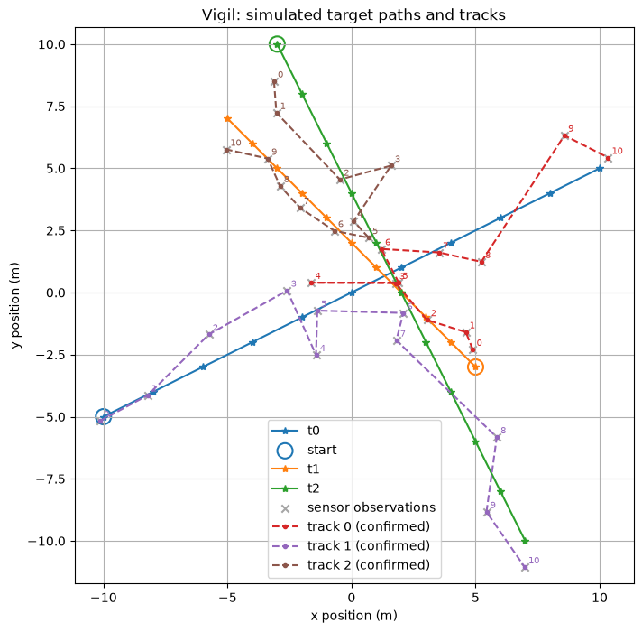

# Vigil

Vigil is a project I'm building to learn multi-object tracking. The goal is to build a tracking system that can take sensor readings like radar and keep track of the objects over several scans. Right now it simulates a few targets moving in 2D, generates fake sensor readings with random noise, and tries to keep a separate track on each target. As the image below shows, it doesn't do that very well yet.

I'm starting this project to learn and implement the math behind sophisticated tracking algorithms, and understand how we can extract information like elevation, distance, and speed from sensor readings. Over time I will also try to implement more realistic sensors and simulators, and if possible even connect it to a real sensor or live data. I also want the tracker to be able to identify (or at least guess) what the target is, like whether it's an aircraft, a ship, or a bird.



## Running it

Requires [uv](https://docs.astral.sh/uv/).

```bash
uv sync
uv run vigil run
```

## What it can do (v0.1.0)

- **Simulator:** three targets moving in straight lines at constant velocity on a flat 2D plane, advanced in 1-second ticks for 10 seconds. They start spread out (ringed in the plot), pass within 2–3 m of each other near the origin at t = 5 s, then carry on outwards.
- **Sensor:** one scan per tick, reporting every target's position with Gaussian noise (σ = 1 m). Each scan's observations are shuffled so their order gives the tracker no hint about which target produced them. There are no missed detections or false alarms yet.
- **Tracker:** sees only the observations, never the true positions. Each new observation is assigned to the nearest existing track within 10 m, judged against that track's most recent observation; otherwise it starts a new track. A track starts as *tentative*, becomes *confirmed* on its second observation, and a tentative track with no follow-up is deleted after 5 scans.
- **Display:** plots the true paths with their starting points ringed, every sensor observation, and the observations each track claimed, labelled with the scan they came from.

## Known issues

- **Every track swaps targets at the crossing.** In the image above, all three tracks start cleanly and follow the right target until the targets meet near the origin at scan 5, then each one leaves with a different target:
  - Track 0 (red) follows t1 for scans 0–4, takes t2's observation at scan 5, then follows t0 from scan 6.
  - Track 1 (purple) follows t0 for scans 0–5, then follows t2 from scan 6.
  - Track 2 (brown) follows t2 for scans 0–4, then follows t1 from scan 5.

  The swaps have two causes:
  - The tracker only compares against a track's last observation and has no idea of velocity. When targets are close together, it can't tell which one is heading where, so it just picks the nearest point.
  - Association is greedy: each observation grabs the closest free track in whatever order the scan arrives, instead of finding the best assignment for all observations at once.
- **Tracks are as jittery as the sensor.** A "track" is just the list of raw observations it claimed, with no smoothing, so sensor noise passes straight through. The true paths are straight lines; the zig-zags are noise. The noise is also large for this scenario: σ = 1 m against targets moving about 2 m per scan.
- **Confirmed tracks are never lost.** `Track.is_lost()` exists but is never called, so a confirmed track that stops receiving observations stays confirmed forever.
- **The simulator is very simple:** only constant-velocity motion, one hand-written scenario, and a perfect detection rate.

## About the name

Named after [Vigil from Rainbow Six Siege](https://rainbowsix.fandom.com/wiki/Vigil_(Siege)#Biography), an operator whose ability makes him invisible to enemy drones and scans, and whose bio describes him as an "exemplary operator in radar systems and stealth technology". It also works as in "keeping vigil": keeping watch.
